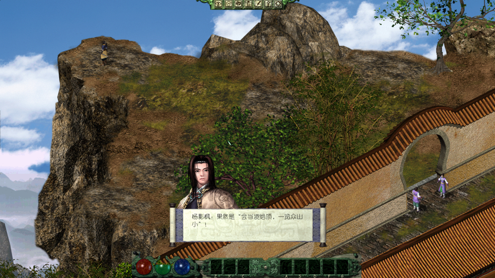
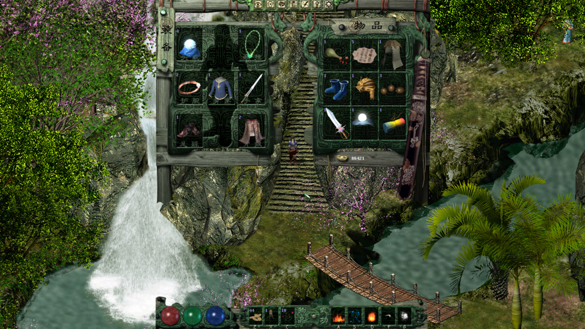
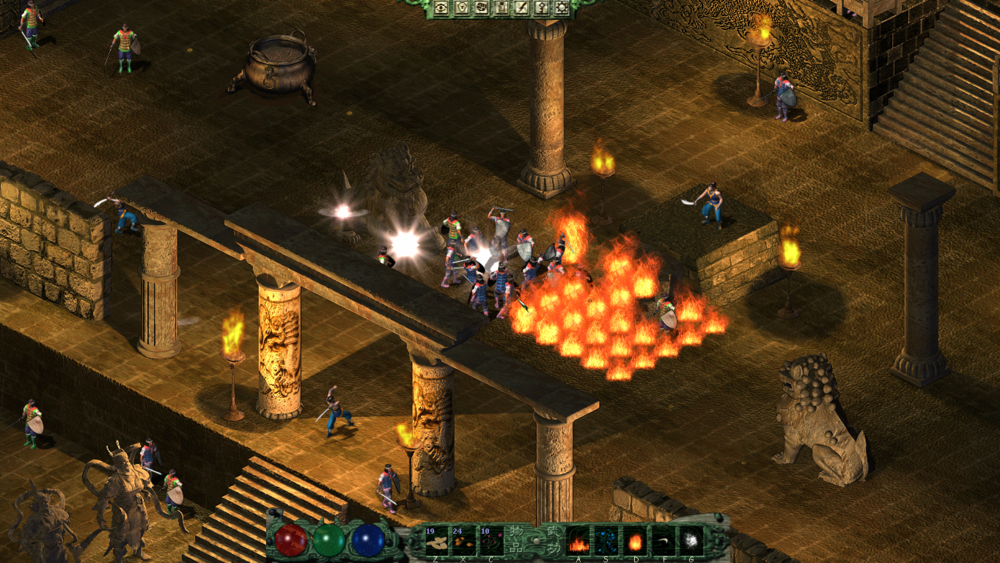

# 剑侠情缘外传 月影传说 高清版

已移植为跨平台版本：运行时使用 **MonoGame DesktopGL** + **.NET 10**，
可在 Windows / macOS / Linux 上构建运行（原 XNA 版仅支持 Windows）。

## Environment Setup
### Requirement
1. .NET 10 SDK

### Build & Run
```bash
dotnet tool restore            # 安装 mgcb 内容构建工具
dotnet build Jxqy.slnx         # 构建游戏与全部工具
cd Data                        # 游戏必须在资源目录下运行
dotnet ../Jxqy/bin/Debug/net10.0/Jxqy.dll
```

游戏资源需放入 `Data/` 目录（[Jxqy_MD5_6E393C16A03FEDC4FF1406205D2EA785.7z](https://github.com/mapic91/JxqyHD/releases/tag/Jxqy_MD5_6E393C16A03FEDC4FF1406205D2EA785.7z)）。
`Data/Content` 中需包含字体 `.xnb` 与特效 `.mgfxo`（特效可由 `Jxqy/tools/mgfxgen.py`
从 `JxqyContent/effect/*.fx` 生成）。

### 工具（Eto.Forms 跨平台 UI）
- `GameStarter` — 启动器：开始游戏 / 游戏设置 / 游戏调试
- `Settings` — 分辨率、音量、游戏速度等设置（写 `Data/Jxqy.ini`）
- `GameEditor` — 调试编辑器：连接以 `--edit` 启动的游戏（本机 TCP 调试协议，
  `Engine/EditServer.cs`，端口 9110），支持作弊、传送、存读档、运行脚本、日志/变量查看
- `xnbbuilder/XNAFormatter` — 内容构建 GUI（调用 `dotnet mgcb`）
- `xnbbuilder/xnaconverter` — 内容构建 CLI：
  `dotnet XNABuilder.dll -o OUTDIR -d SRCDIR [-p DesktopGL] [-c]`

注：特效（.fx）编译在 macOS/Linux 上仍需要 Wine；本仓库改用预生成的
`.mgfxo` 文件，无需 mgcb 构建特效。视频播放在 DesktopGL 下不支持，会自动跳过。

### Screenshots




